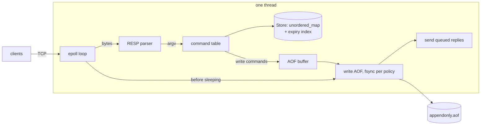

# kvstore

A Redis-compatible in-memory key-value server in C++20. Real clients (`redis-cli`,
`redis-benchmark`, go-redis) talk to it unchanged. It runs one thread with an
epoll event loop, persists to an append-only file, and uses no third-party libraries.

It is the cache layer of [taskq](../taskq), a job queue that uses kvstore for rate
limiting and idempotency keys.

```
$ redis-cli -p 6380 set greeting hello EX 60
OK
$ redis-cli -p 6380 ttl greeting
(integer) 60
```

## Supported commands

| Group | Commands |
|---|---|
| Strings | `GET`, `SET` (with `EX PX EXAT PXAT NX XX GET KEEPTTL`), `INCR`, `DECR`, `INCRBY`, `DECRBY` |
| Keys | `DEL`, `EXISTS`, `TYPE`, `EXPIRE`, `PEXPIRE`, `EXPIREAT`, `PEXPIREAT`, `TTL`, `PTTL`, `PERSIST`, `DBSIZE`, `FLUSHALL` |
| Lists | `LPUSH`, `RPUSH`, `LPOP`, `RPOP` (with count), `LRANGE` (negative indices), `LLEN` |
| Pub/sub | `SUBSCRIBE`, `UNSUBSCRIBE`, `PUBLISH` |
| Server | `PING`, `ECHO`, `QUIT`, `SELECT 0`, `BGREWRITEAOF`, `CONFIG GET`, `COMMAND`, `CLIENT` |

The protocol is RESP2, plus inline commands, so `nc localhost 6380` works too. Error
messages match Redis (`WRONGTYPE …`, `ERR wrong number of arguments …`).

## Architecture



One loop iteration:

1. `epoll_wait` (level-triggered), with the timeout set to the next timer tick.
2. For each readable client: read until `EAGAIN`, parse **every** complete command in
   the buffer (pipelining), and run each one. Replies are appended to the client's
   write buffer. Write commands are appended to the AOF buffer.
3. Every 100 ms: active expiry and the `everysec` fsync.
4. Before sleeping: write the AOF buffer, fsync it if the policy is `always`, then
   send all queued replies with one `send()` per client. A client never sees `+OK`
   for a write that the log doesn't have yet.
5. Close the clients that were marked for closing during this iteration.

| File | What it does |
|---|---|
| [src/fd.h](src/fd.h) | Move-only RAII file descriptor; a socket closes on every error path. |
| [src/resp.cpp](src/resp.cpp) | Incremental parser: a partial frame returns *Incomplete* and is never assumed whole. Also the reply writers. |
| [src/server.cpp](src/server.cpp) | Event loop, per-client buffers, backpressure, pub/sub fan-out, AOF loading. |
| [src/commands.cpp](src/commands.cpp) | Dispatch table and handlers. |
| [src/store.cpp](src/store.cpp) | Keyspace plus a set of keys that have a TTL, used for active expiry sampling. |
| [src/aof.cpp](src/aof.cpp) | Append-only file: buffering, fsync policies, rewrite with `rename()`. |

## Running

```bash
cmake --preset release && cmake --build --preset release
build/release/kvstore --port 6380 --fsync everysec
redis-cli -p 6380 ping
```

Options: `--port`, `--bind`, `--appendonly yes|no`, `--aof-file`,
`--fsync always|everysec|no`, `--pubsub-output-limit`. Docker:
`docker build -t kvstore . && docker run -p 6380:6380 kvstore`.

Build presets: `release` (`-O2 -g`), `debug`, and `asan` (AddressSanitizer +
UndefinedBehaviorSanitizer).

## Testing

| Test | What it checks |
|---|---|
| `ctest --preset release` | Parser (including a command fed **one byte at a time**, pipelined frames, garbage), store expiry, and every command handler. |
| `tests/integration.sh` | The real `redis-cli` against the server: commands, TTLs, pub/sub, the inline protocol, `kill -9` then restart, a truncated AOF tail, `BGREWRITEAOF`. |
| `tests/replay_check.sh` | Random traffic, dump the keyspace, restart from the AOF, dump again: the two dumps must be identical, also after a rewrite. |
| `tests/stress.py` | 50 clients sending random commands in random-sized fragments, plus garbage frames, slow subscribers and a publisher flood. |

The stress test ran for 2 minutes against the ASan+UBSan build: **6.3 M commands,
2,492 malformed frames, 0 sanitizer reports**. CI runs all of the above on every
push.

## Benchmarks

`bench/bench.sh`: kvstore and Redis 7.0.15 with the same `redis-benchmark` flags
(`-t set,get -n 1000000 -c 50 -r 100000`). Both servers log every write to an AOF
with the same fsync policy. Hardware: AMD Ryzen 7 7735HS (8 cores / 16 threads),
NVMe SSD, loopback network.

**fsync = everysec**

| | pipeline | SET ops/s | SET p99 | GET ops/s | GET p99 |
|---|---|---|---|---|---|
| kvstore | 1 | 103,263 | 0.40 ms | 104,395 | 0.39 ms |
| Redis | 1 | 106,564 | 0.48 ms | 102,944 | 0.48 ms |
| kvstore | 16 | 1,223,990 | 0.86 ms | 1,400,560 | 0.70 ms |
| Redis | 16 | 794,912 | 1.42 ms | 1,308,900 | 0.90 ms |

**SET throughput by fsync policy** (pipeline 1 / pipeline 16)

| policy | kvstore | Redis |
|---|---|---|
| `no` | 106,258 / 1,287,001 | 106,360 / 798,084 |
| `everysec` | 103,263 / 1,223,990 | 106,564 / 794,912 |
| `always` | 21,294 / 292,397 | 21,003 / 257,400 |

How to read these numbers:

- **Without pipelining, both servers are at about 105k ops/s.** That is the cost of a
  loopback round trip per command, not of either server.
- **Pipelining (`-P 16`) multiplies throughput about 12×,** because one `read()`,
  one parse pass and one `send()` now cover 16 commands.
- **`fsync=always` costs about 5×.** Each loop iteration waits for the disk. Batching
  all writes in an iteration into one `fdatasync` is what keeps it at 21k ops/s and
  not at a few thousand.
- **kvstore beats Redis on pipelined SET mostly because it does less.** It has no
  memory accounting or eviction, no keyspace notifications, no replication
  backlog, and no special encodings. This shows that the event loop and parser are
  not the bottleneck. It does not show that kvstore is "faster than Redis".

### Profiling and the optimization

perf is blocked on the development machine (`perf_event_paranoid=4`), so the profile
came from gprof (user-space only) on the pipelined SET/GET workload. **77% of
user time was in `_Hashtable::_M_find_before_node`**, the bucket-chain walk of
the keyspace map. Each lookup was cache-missing, and the cause was the size of the
nodes: `Entry` held a `std::variant<std::string, std::deque<…>>`, and a deque is
80 bytes, so every entry, strings included, was 96 bytes.

Two changes, measured with `bench/cpu.sh` (server CPU per operation from
`/proc/<pid>/stat`, 3 runs each, 4 M pipelined ops):

| change | user CPU / op | pipelined SET ops/s |
|---|---|---|
| baseline | 512 ns | ~0.96 M |
| lists behind `unique_ptr` (Entry 96 → 48 bytes) | 472 ns | ~1.0 M |
| AOF entries serialized in place (no `vector<string>` per write) | **431 ns** (−16%) | **1.14 M** |

## Design decisions

- **Single-threaded.** Commands never run concurrently, so there are no locks and
  every command is atomic for free. That's why `INCR` is safe with many clients.
  The CPU work per command is small next to the syscalls around it.
- **Closing is deferred to the end of the iteration.** Closing a socket right away
  would let `accept()` reuse the same fd number while later events in the same
  `epoll_wait` batch still refer to the old client, and it would free `Client`
  objects that `PUBLISH` may be iterating over.
- **Backpressure.** A subscriber whose unsent output exceeds 8 MB is disconnected.
  A normal client that stops reading its replies stops being read from at 64 MB,
  instead of growing the buffer forever.
- **Expiry is stored as absolute unix ms.** `SET k v EX 10` is logged as
  `SET k v PXAT <ms>` and `EXPIRE` as `PEXPIREAT`, so a replay an hour later doesn't
  give the key a fresh 10 seconds.
- **Expirations are logged as `DEL`, and nothing expires during load.** The replay
  check caught a real bug here. Suppose `k` has a TTL and is live when `INCR k` runs.
  On replay, the TTL is already in the past, so the old code treated `k` as gone and
  `INCR` created a new key with no TTL, which differs from the original. Redis solves
  this the same way: the log records exactly when each key disappeared, so replay
  never has to guess.
- **A truncated last record is cut off with a warning, not treated as fatal.** A crash
  mid-`write()` leaves half a command. Its client never got a reply, so dropping it
  is correct. Garbage anywhere else is still a fatal error.
- **AOF rewrite runs synchronously.** It writes a temp file, fsyncs it, `rename()`s
  it over the old file, then fsyncs the directory. `rename` is atomic, so a crash
  leaves either the old file or the new one, never a mix. Redis forks a child for
  this so the server doesn't pause; that is listed under future work.
- **Lazy plus active expiry.** Lazy expiry alone leaks keys that are never read
  again. The active cycle samples 20 keys from the TTL set every 100 ms and repeats
  while more than 25% of a sample had expired, like Redis.

## Future work

Background AOF rewrite (fork, or a thread with copy-on-write snapshots); `fsync` on
a background thread for `everysec`; more data types (hashes, sets, sorted sets);
`MULTI`/`EXEC`; replication; I/O threads for parsing and writing while command
execution stays single-threaded.
